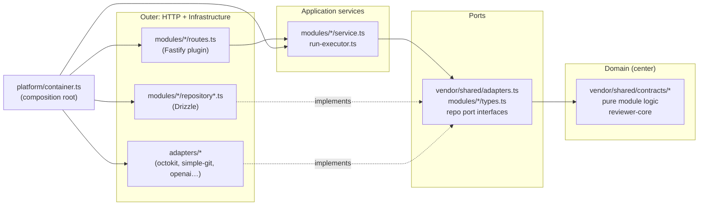

# Onion Architecture — `server/`

**The rule:** source code dependencies point **only inward**. Inner rings define interfaces; outer rings
implement them. The database, Fastify, GitHub, and LLM SDKs are *external* — they are never the center.

Scope: `server/src/**` only. `reviewer-core` is already a pure core (see its `CLAUDE.md`); `client/` is out of scope.

## Rings in this codebase

| Ring | Files | May import | Must NOT import |
|---|---|---|---|
| Domain | `vendor/shared/contracts/*`, pure module files (`pulls/status.ts`, `reviews/findings.ts`, `*/helpers.ts`, `*/constants.ts`), `@devdigest/reviewer-core` | `zod`, other domain files | everything below |
| Ports | `vendor/shared/adapters.ts`, `modules/<name>/types.ts` (e.g. `RepoIntel`), repository interfaces | domain | drizzle, fastify, SDKs, `db/*` |
| Application | `modules/<name>/service.ts`, orchestrators like `reviews/run-executor.ts` | domain, ports, `platform/errors.ts` | `drizzle-orm`, `db/*`, `fastify`, `adapters/*`, SDKs, `process.env` |
| Infrastructure | `modules/<name>/repository*.ts`, `adapters/**`, `db/**` | ports, domain, its own library | `fastify`, application services, routes |
| HTTP entry | `modules/<name>/routes.ts`, `app.ts`, `server.ts` | application services, `_shared/context.ts`, `_shared/schemas.ts`, `platform/errors.ts`, contracts | `drizzle-orm`, `db/*`, `adapters/*`, SDKs |
| Composition root | `platform/container.ts` (+ `ContainerOverrides`) | everything | — (the only place concrete classes meet interfaces) |

Full import matrix and examples from our code: [references/layers.md](references/layers.md).

## Hard rules

### routes.ts — thin HTTP adapter
- MUST: declare Zod `params`/`querystring`/`body`/`response` schemas via `withTypeProvider<ZodTypeProvider>()`,
  call `getContext(container, req)`, call **one** service method, return its DTO.
- MUST NOT: import `drizzle-orm`, `db/schema`, `db/client`, `adapters/*`, or an SDK; contain business rules;
  open transactions; build `AppError` responses by hand (throw, the global handler in `app.ts` formats).
- Details: [references/fastify.md](references/fastify.md).

### service.ts — application service (use case)
- MUST: receive its dependencies as **interfaces** through the constructor (a repository port, `LLMProvider`,
  `GitHubClient`, `RepoIntel`, …). The route plugin or `Container` builds it.
- MUST NOT (new code): take the whole `Container`, call `new XRepository(container.db)`, import `drizzle-orm`,
  `db/*`, `fastify`, `adapters/*`, or SDKs, read `process.env`/secrets directly.
- Throws `AppError` subclasses (`NotFoundError`, `ValidationError`, `ExternalServiceError`, `ConfigError`)
  from `platform/errors.ts` — never HTTP status codes or `reply`.

### repository.ts — infrastructure
- The ONLY place `drizzle-orm` and `db/schema` are imported inside `modules/`.
- MUST implement a port interface the service depends on (declare it in `modules/<name>/types.ts` or next to the
  service, not in the repository file).
- MUST map rows → domain/DTO types at the boundary; `*Row` types (`db/rows.ts`) do not leave infrastructure.
- Transactions: open with `db.transaction(async (tx) => …)` inside the repository, or behind a unit-of-work port
  — never in a route. Translate driver errors (unique violation, FK) into `AppError` subclasses here.
- Details: [references/drizzle.md](references/drizzle.md).

### New external system (API, CLI, library)
1. Port interface in `vendor/shared/adapters.ts` (then mirror in `client/src/vendor/shared` and typecheck all
   packages — root `CLAUDE.md`) or, if server-only, in `modules/<name>/types.ts`.
2. Implementation in `adapters/<name>/`.
3. Mock in `adapters/mocks.ts` (`Mock<Name>` implementing the port).
4. Lazy getter in `Container` + optional field in `ContainerOverrides`.
5. Secrets only via `SecretsProvider`, resolved inside the getter.

### Domain / pure logic
- No I/O, no `Date.now()`/randomness passed implicitly (take them as arguments), no imports from outer rings.
- Testable with plain Vitest, no mocks, no Docker.
- Review logic (prompt assembly, grounding, structured output) stays in `reviewer-core`.

### Cross-module
- Use another module only through its service or facade (e.g. `container.repoIntel`, `container.agentsRepo`).
- Never import another module's `repository.ts` or `routes.ts` directly.

### Validation (Zod)
- Parse at the edge (route schemas), then pass typed values inward — services do not re-validate.
- Contracts in `vendor/shared/contracts` are domain types: no DB or HTTP specifics in them.
- Details: [references/zod.md](references/zod.md).

## Where does this code go?

1. Does it talk HTTP (request, reply, status, headers)? → `routes.ts`.
2. Does it touch the DB, filesystem, network, git, or an SDK? → repository or adapter, behind a port.
3. Does it coordinate several ports to fulfil one user action? → `service.ts`.
4. Is it a rule/calculation over data already in memory? → pure domain file (`helpers.ts`, `status.ts`, …).
5. Is it choosing *which* implementation to use? → `platform/container.ts`.

## Legacy policy

Existing code already breaks some rules (routes in `settings`, `workspace`, `polling`, `pulls` import Drizzle;
services take `Container`; `reviews/run-executor.ts` and `diff-loader.ts` import `db/schema`). Do **not** start
mass refactors. Rules apply to **new code** and to **files the task already changes**: when you edit such a
file, fix the violation you touch, within that file, if it is small; otherwise leave a note to the user.
Never change behavior while moving code across rings.

## Testing per ring
- Domain: plain unit tests. Application: unit tests with mocks from `adapters/mocks.ts` or in-memory repo ports.
- HTTP: `buildApp({ overrides })` + `app.inject()`. Infrastructure: `*.it.test.ts` with `test/helpers/pg.ts`.
- Details: [references/testing.md](references/testing.md).

## Pre-finish checklist

Run for every changed/added file under `server/src`:

- [ ] `grep -lE "drizzle-orm|db/schema|db/client" <changed routes.ts / service.ts>` → empty for new code.
- [ ] `grep -l "from 'fastify'" <changed service.ts / repository.ts / domain files>` → empty.
- [ ] New service takes interfaces in its constructor, not `Container`; no `new …Repository(` inside services.
- [ ] Every new external dependency has: port → adapter → mock → `Container` getter → `ContainerOverrides` field.
- [ ] Repository returns DTO/domain types, not `*Row`; transactions live in infrastructure.
- [ ] Errors are `AppError` subclasses; no `reply.code(...)` for domain errors in routes.
- [ ] Route schemas validate input; no hand-rolled `Schema.parse(req.body)`.
- [ ] No import of another module's `repository.ts`/`routes.ts`.
- [ ] Unit tests for domain/service run without Docker; DB tests are named `*.it.test.ts`.
- [ ] `pnpm typecheck` passes in `server/` (and other packages if a contract changed).

## Related skills
`fastify-best-practices` · `drizzle-orm-patterns` · `zod` · `typescript-expert` · `engineering-insights`.
Examples: [examples.md](examples.md) · Sources: [references.md](references.md).
