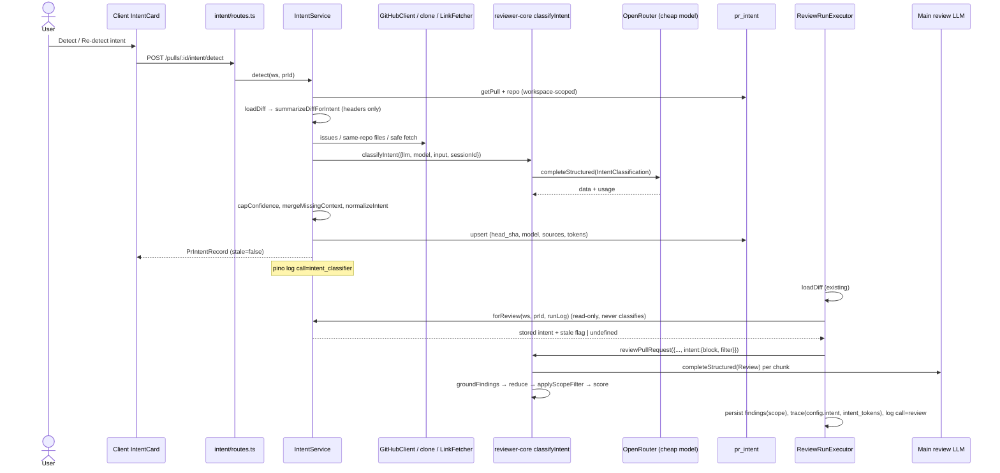

# Development Plan: M3 Intent layer

**Status:** approved by the user 2026-11-27, with these decisions:
- "Serious" out-of-scope = `severity === 'CRITICAL'` OR `category === 'security'`.
- External link fetching is ON by default (SSRF guard; kill switch `INTENT_LINK_FETCH=false`).
- **No auto-detect during a review run.** Intent is classified only by the user ("Detect" / "Re-detect" button). `INTENT_AUTO_DETECT` does not exist.
- **This iteration adds NO new tests** (user decision). Every planned test below is listed as *deferred*. All existing checks must still be run and pass.

**Goal:** A separate cheap OpenRouter call classifies a PR into a structured intent (summary, in/out of scope, risk areas) from safely fetched, status-labelled sources. The intent is stored per PR with a staleness flag, shown on the PR Overview, injected into the reviewer prompt, and a deterministic post-grounding filter drops out-of-scope findings but keeps exactly one serious out-of-scope signal.

**Non-goals:** Smart Diff; PR Brief (M5) — `PrBrief.intent` only follows the renamed field; Jira/Linear API integration (marked unavailable); intent history; auto re-classification; seed row for intent; CI runner changes.

**Modules touched:** shared-contracts | reviewer-core | server | client (e2e: verification only)

---

## 0. Inventory — reuse, don't recreate
| Piece | State | Plan |
|---|---|---|
| `pr_intent` table (`server/src/db/schema/reviews.ts:48-54`; `pr_id` PK, `intent` text, `in_scope`/`out_of_scope` jsonb) | exists, unused | Extend with new columns. Keep column `intent`, map it to `summary` (avoid drizzle-kit rename prompt) |
| `Intent` zod (`contracts/brief.ts:9-14`) | used only by `PrBrief`/`PrIntentRecord` | Reshape (see Contracts) |
| `PrIntentRecord` (`review-api.ts:59-61`) | unused | Redefine |
| `upsertIntent`/`getIntent` (`reviews/repository/pull.repo.ts:47-68`, `reviews/repository.ts:128-136`) | dead | Move to `modules/intent/repository.ts`; delete from reviews |
| `FeatureModelId 'review_intent'` (`contracts/platform.ts`), `client/src/lib/feature-models.ts` mirror, Settings → Models picker | exists; default `openai/gpt-4.1` | Change default only → `openrouter` / `google/gemini-2.5-flash-lite` in both places. `resolveFeatureModel` resolves it |
| `model-router.ts` `routeModel('intent')` | unused, stale | Do not use |
| `GitHubClient.getIssue` (`adapters.ts:164`, `octokit.ts:351-364`), mock | exists | Reuse. Add `listClosingIssues` (GraphQL `closingIssuesReferences`) |
| `INJECTION_GUARD` (`reviewer-core/src/prompt.ts:16-28`) | exists | Do not weaken. Intent block goes in `<untrusted source="pr-intent">` |
| `RunLogger` "derive intent" comments (`run-logger.ts`, `run-executor.ts`) | comments only | Implement "load stored intent" in pre-work |
| `readContainedFile` (`platform/contained-read.ts:18`) | exists | Reuse for same-repo spec/plan links |
| `OpenRouterProvider.completeStructured` (`reviewer-core/src/llm/openrouter.ts`) | exists | Reuse as is |

## 1. Data sources (`IntentService`, caps in `modules/intent/constants.ts`)
| Source | From | Cap / rule |
|---|---|---|
| PR title, author, body | DB `pull_requests` | body ≤ 4000 chars; empty → `pr_description` source `skipped` |
| Changed files + hunk headers | `loadDiff` (`reviews/diff-loader.ts`) → pure `summarizeDiffForIntent` (reviewer-core) | path, +/-, `@@ … @@ <heading>` only; ≤ 200 files, ≤ 10 headers/file, ≤ 12 000 chars. **No body lines** |
| Linked issues | `GitHubClient.listClosingIssues` ∪ regex refs in body (`#N`, `fixes #N`, `owner/repo#N`, `github.com/o/r/issues/N`) → `getIssue` | ≤ 3 issues, body ≤ 3000 chars; 404/410/error → `unavailable` + reason; no token (`ConfigError`) → `unavailable: GitHub not configured` |
| Same-repo plan/spec | `github.com/<owner>/<repo>/blob/<ref>/<path>` or relative `*.md` → `readContainedFile(clonePath, path)` | ≤ 6000 chars; not cloned/unreadable → `unavailable` |
| External URLs | `LinkFetcher` port → `SafeLinkFetcher` adapter | ≤ 3 URLs; http/https; 5 s timeout; 512 KB stream cap; ≤ 3 redirects each re-validated; content-type allowlist (text/html, text/plain, text/markdown, application/json); HTML tag strip → ≤ 6000 chars; `INTENT_LINK_FETCH=false` → `skipped` |
| Jira/Linear (`[A-Z][A-Z0-9]+-\d+`, `*.atlassian.net`, `linear.app`) | not fetched | `unavailable: credentials required`; key/URL kept as text signal |

Total sources budget ≤ 16 000 chars, trimmed by priority: issue > same-repo spec > external.

## 2. Call sequence

## 3. Scope filter (decision)
- When intent is present, a trusted `SCOPE_RULES` paragraph in the system message (before `INJECTION_GUARD`) tells the model to tag every finding `scope: "in_scope" | "out_of_scope"` and to always report serious out-of-scope defects.
- Pure `applyScopeFilter` in `reviewer-core/src/scope-filter.ts` runs in `reviewPullRequest` **after** `groundFindings` and after map-reduce `reduceReviews` (global across chunks), then `scoreFromFindings` on the remainder.
- Rule: (1) not `out_of_scope` → keep. (2) out-of-scope, not serious → drop (`out of PR scope`). (3) serious out-of-scope → sort by (severity rank, confidence desc, file, start_line, title), keep first, append to its rationale `\n\n_Outside this PR's stated scope; N more serious out-of-scope issue(s) collapsed._`, drop rest (`collapsed into one out-of-scope signal`).
- Serious = `severity === 'CRITICAL' || category === 'security'`.
- Filter OFF (tags kept, nothing dropped) when: no intent; stale (`head_sha !== pull.headSha`); confidence `low`. The block is still injected when stale. Executor decides `filter`, reviewer-core obeys.

## Constraints
- C1 Onion: thin routes (zod schemas, `getContext`, one service call); services take interfaces, no drizzle/fastify/adapters/`process.env`.
- C2 New external system: port → adapter → `Mock*` in `adapters/mocks.ts` → lazy Container getter → `ContainerOverrides` field. Secrets via `SecretsProvider`.
- C3 Validate via route zod schemas.
- C4 Throw `AppError` subclasses (`NotFoundError`, `ExternalServiceError`, `ConfigError`).
- C5 Review logic lives in reviewer-core and stays pure; empty optional slots must give an identical prompt.
- C6 Don't weaken `INJECTION_GUARD`/`wrapUntrusted`; `groundFindings` stays mandatory; score recomputed from final findings.
- C7 Zod contracts in two byte-identical copies; typecheck all packages.
- C8 `client/src/lib/feature-models.ts` mirrors `FEATURE_MODELS`.
- C9 Migrations immutable; new only via `pnpm db:generate`; **applying needs user approval**.
- C10 New run-trace fields set in 4 writers + `getRunTrace`, `.nullish()` in the contract.
- C11 New LLM prompt text in TS, not `src/prompts/*.md`.
- C13 Client: data via `src/lib/hooks/*` → `src/lib/api.ts`; component = `_components/<Name>/`; all text via next-intl.
- C14 `client/src/vendor/**` mirrored from server copy.
- C15 pnpm in server/client, npm in reviewer-core; `@devdigest/*` aliases only.
- C16 Never log secrets/tokens/full content; http/https only.
- C17 Add new mocks; don't change existing mock behaviour (reviewer-core tests import `server/src/adapters/mocks.ts`).
- C18 Cross-module access only via service / Container facade.
- **C19 No new test files and no new test cases in this iteration.** Existing tests may be minimally adjusted only if a contract change breaks them to compile/pass (e.g. a fixture missing a now-required field); report every such adjustment.

## Reuse
- `modules/conventions/routes.ts` + `conventions/types.ts`: ports-based service with a `ModelResolver` (`resolveFeatureModel` + `c.llm(choice.provider)`).
- `modules/conventions/service.ts`: single `completeStructured` with `temperature: 0`, provider errors → `ExternalServiceError`.
- `reviewer-core/src/prompt.ts` `wrapUntrusted`.
- `reviews/diff-loader.ts` `loadDiff`; `platform/contained-read.ts` `readContainedFile`; `platform/run-logger.ts` `RunLogger.step`.
- `run-executor.ts` skills token accounting (`tokenizer.count`) → copy for `intent_tokens`.
- `client/src/lib/hooks/conventions.ts`: mutation that `setQueryData`s its result.

## Contracts (both copies, identical)
`contracts/brief.ts`:
- `IntentConfidence = z.enum(['high','medium','low'])`
- `Intent = z.object({ summary: z.string(), in_scope: z.array(z.string()).max(8), out_of_scope: z.array(z.string()).max(8), risk_areas: z.array(z.string()).max(6) })`
- `IntentClassification = Intent.extend({ confidence: IntentConfidence, missing_context: z.array(z.string()).max(6) })` (LLM output schema; string lengths truncated in code by `normalizeIntent`)
- `IntentSourceKind = z.enum(['pr_title','pr_description','diff_headers','linked_issue','repo_doc','external_link','ticket'])`
- `IntentSourceStatus = z.enum(['fetched','unavailable','skipped'])`
- `IntentSource = z.object({ kind, ref: z.string(), title: z.string().nullish(), status, reason: z.string().nullish(), chars: z.number().int() })`

`contracts/review-api.ts`:
- `PrIntentRecord = Intent.extend({ pr_id, confidence, missing_context: z.array(z.string()), sources: z.array(IntentSource), head_sha: z.string().nullable(), stale: z.boolean(), provider: z.string().nullable(), model: z.string().nullable(), tokens_in: z.number().int().nullable(), tokens_out: z.number().int().nullable(), cost_usd: z.number().nullable(), updated_at: z.string() })`
- `PrIntentResponse = z.object({ intent: PrIntentRecord.nullable() })`

`contracts/findings.ts`: `FindingScope = z.enum(['in_scope','out_of_scope'])`; `Finding.scope: FindingScope.nullish()` (reaches the LLM `Review` schema and `FindingRecord`).

`contracts/trace.ts`: `PromptAssembly.intent: z.string().nullish()`, `intent_tokens: z.number().int().nullish()`; `RunTrace.config.intent: z.object({ head_sha: z.string().nullable(), stale: z.boolean(), confidence: IntentConfidence, filter_applied: z.boolean(), scope_dropped: z.number().int() }).nullish()`.

`contracts/platform.ts`: `review_intent` default → `defaultProvider:'openrouter', defaultModel:'google/gemini-2.5-flash-lite'`; mirror in `client/src/lib/feature-models.ts`.

`adapters.ts` (port, both copies): `GitHubClient.listClosingIssues(repo: RepoRef, n: number): Promise<{ owner: string; name: string; number: number }[]>`.

## Migration
Edit `server/src/db/schema/reviews.ts` (`prIntent`, `findings`), then `cd server && pnpm db:generate` → `0012_<generated>.sql` + meta. Expected, additive only:
- `pr_intent`: `risk_areas jsonb NOT NULL DEFAULT '[]'`, `confidence text NOT NULL DEFAULT 'low'`, `missing_context jsonb NOT NULL DEFAULT '[]'`, `sources jsonb NOT NULL DEFAULT '[]'`, `head_sha text`, `provider text`, `model text`, `tokens_in integer`, `tokens_out integer`, `cost_usd double precision`, `created_at timestamptz NOT NULL DEFAULT now()`, `updated_at timestamptz NOT NULL DEFAULT now()`.
- `findings`: `scope text`.
- Generate only. Do NOT run `pnpm db:migrate` / `./scripts/dev.sh`. If `db:generate` asks a rename question, stop and fix the schema.

## Steps
| # | Module | Files | Change | Skills |
|---|---|---|---|---|
| 1 | contracts | M `server/src/vendor/shared/contracts/{brief,review-api,findings,trace,platform}.ts` + client copies; M `reviews/repository.ts`, `reviews/repository/pull.repo.ts` (delete dead intent accessors) | Contracts above | zod, typescript-expert, onion-architecture, drizzle-orm-patterns |
| 2 | reviewer-core | C `src/intent.ts`, C `src/scope-filter.ts`, M `src/prompt.ts`, M `src/review/run.ts`, M `src/index.ts` | (a) `summarizeDiffForIntent`; (b) `INTENT_SYSTEM_PROMPT` + `buildIntentMessages` (every source via `wrapUntrusted`; unavailable → `UNAVAILABLE: <ref> — <reason> (do not guess its content)`); (c) `classifyIntent({llm, model, input, sessionId})` → `{data, tokensIn, tokensOut, costUsd, messages}`, `temperature:0`, `schemaName:'IntentClassification'`; (d) `renderIntentBlock(intent, {stale, confidence})`; (e) `PromptParts.intent?` → user section `## PR intent` (untrusted `pr-intent`) right after `## PR description`, + `SCOPE_RULES` in system before `INJECTION_GUARD`, both only when intent non-empty; `assembly.intent`; (f) `ReviewInput.intent?: {block, filter}`, `applyScopeFilter` after grounding+reduce, `ReviewOutcome.scopeDropped`, info event per drop | typescript-expert, security |
| 3 | server DB | M `db/schema/reviews.ts`; C generated `0012_*` | Migration above | postgresql-table-design, drizzle-orm-patterns |
| 4 | server adapters | M both `vendor/shared/adapters.ts` (`listClosingIssues`); M `adapters/github/octokit.ts`; C `adapters/http/ip-guard.ts`; C `adapters/http/safe-fetch.ts` (`SafeLinkFetcher implements LinkFetcher`); M `adapters/mocks.ts` (add `MockLinkFetcher`; `MockGitHub.listClosingIssues` → `[]`); M `platform/container.ts` (`linkFetcher` + `ContainerOverrides.linkFetcher`); M `platform/config.ts` (`INTENT_LINK_FETCH`, default true) | `SafeLinkFetcher`: `node:http`/`node:https` `request` with a custom `lookup` that rejects loopback/RFC1918/link-local/169.254/0.0.0.0/`::`/fc00::/7/IPv4-mapped/NAT64/non-2000::/3 IPv6 and connects to the vetted address; manual redirects (≤3, re-validated); no cookies/auth; timeout; byte cap; content-type allowlist; returns `{status:'fetched', text, title} \| {status:'unavailable', reason}`, never throws. No new npm dependency. Port `LinkFetcher` in `modules/intent/types.ts` | onion-architecture, security |
| 5 | server intent module | C `modules/intent/{types,constants,helpers,repository,service,routes}.ts`; M `modules/index.ts`; M `platform/container.ts` (`intentService`) | **helpers (pure):** `extractRefs`, `classifyLink`, `capConfidence` (no description and nothing fetched → `low`; any unavailable → ≤ `medium`), `mergeMissingContext` (unavailable-source entries first, ≤6), `normalizeIntent` (summary 600, items 200, risk 80), `redactUrl` (drop userinfo/query/fragment), `isStale`. **service:** `get(ws, prId)` → `PrIntentResponse` with `stale`; `detect(ws, prId)` → gather → `classifyIntent` → cap → upsert → record (provider error → `ExternalServiceError`, missing key → `ConfigError`); `forReview(ws, prId, log)` → stored `{record, stale}` or `undefined`, **read-only, never classifies, never throws**. **routes:** `GET /pulls/:id/intent` → `PrIntentResponse`; `POST /pulls/:id/intent/detect` → `PrIntentRecord`, `rateLimit {max:10, timeWindow:'1 minute'}`. **Pino log:** `{call:'intent_classifier', prId, provider, model, estTokensIn, tokensIn, tokensOut, costUsd, sources:[{kind, ref:redactUrl, status, chars}]}` — never body/issue/doc/diff text | onion-architecture, fastify-best-practices, drizzle-orm-patterns, security |
| 6 | server run path | M `reviews/run-executor.ts`, `reviews/repository/review.repo.ts` (`insertFindings` writes `scope`), `reviews/helpers.ts` (`findingRowToDto` maps `scope`), `reviews/repository/run.repo.ts` (`getRunTrace` nulls new fields), `platform/trace-builder.ts` (`buildRunTrace`, `emptyPromptAssembly`) | After `loadDiff` call `container.intentService.forReview(...)`. Log `intent: using stored (model…, sha…, confidence…, sources n fetched / m unavailable)[, STALE — scope filter off]` or `intent: none detected — review runs without intent`. Pass `intent:{block, filter: !stale && confidence!=='low'}`. Before the call `runLog.tool('Main review call → <provider>/<model>', {call:'review'})`; after it `runLog.info` with per-slot token counts (system, skills, pr_description, intent, repo_map, callers, user) + actual tokensIn/out. Trace: `config.intent` + `prompt_assembly.intent`/`intent_tokens` on success; nulls in `traceFromBuffer` | onion-architecture, drizzle-orm-patterns, security |
| 7 | client data | C `client/src/lib/hooks/intent.ts`; M `client/src/lib/feature-models.ts` | `usePrIntent(prId)` key `["pr-intent", prId]`; `useDetectIntent(prId)` → `setQueryData` | frontend-ui-architecture, react-best-practices |
| 8 | client UI | C `…/pulls/[number]/_components/IntentCard/{IntentCard.tsx,helpers.ts,styles.ts,index.ts}`; M `OverviewTab.tsx` (+`prId`, IntentCard above Description, move "Description" string to i18n); M `page.tsx` (pass `prId`; invalidate `["pr-intent", prId]` in `onRunDone`); M `FindingCard.tsx` ("Outside PR scope" chip); M `TraceBody.tsx` + `RunTraceDrawer/constants.ts` (intent `PromptBlock`); C `client/messages/en/intent.json`; M `prReview.json`, `runs.json` | IntentCard states: loading; empty ("Intent not detected yet" + Detect); error; populated (quoted summary, In/Out columns, risk chips, sources with status + redacted ref + reason, confidence badge, missing-context badge, Stale badge with short sha, Re-detect disabled while pending, footer model + tokens/cost). Refs rendered as text, not `href` | frontend-ui-architecture, react-best-practices, next-best-practices |
| 9 | docs | M `docs/agent-prompts/README.md` | User-message order gets `## PR intent`; SCOPE_RULES; scope filter rule | — |

## Deferred tests (NOT in this iteration — C19)
`server/test/contracts.test.ts` additions; `reviewer-core/test/{intent,scope-filter}.test.ts` + `prompt.test.ts`/`run.test.ts` additions; `server/test/{safe-fetch,intent-helpers,intent-service}.test.ts`; `server/test/intent.it.test.ts`; `server/test/run-intent.it.test.ts` (detect via POST, then run review; assert two distinct `completeStructured` calls `IntentClassification` vs `Review`); client `IntentCard.test.tsx`, `FindingCard`/`TraceBody` additions.

## Verification (existing checks only, in order)
1. `cd reviewer-core && npm run typecheck && npm test`
2. `cd server && pnpm typecheck && pnpm exec vitest run --exclude '**/*.it.test.ts'`
3. `cd server && pnpm db:generate` → exactly one new `0012_*.sql`; no tracked migration changed.
4. `cd server && pnpm exec vitest run .it.test` (Docker; throwaway DB) — existing suites pass.
5. `diff -r server/src/vendor/shared client/src/vendor/shared` → empty.
6. `cd client && pnpm typecheck && pnpm test`
7. Onion grep: `grep -lE "drizzle-orm|db/schema|db/client|from 'fastify'" server/src/modules/intent/{service,helpers,types}.ts` → empty, and `grep -lE "drizzle-orm|db/schema|db/client" server/src/modules/intent/routes.ts` → empty (routes may import `FastifyInstance`, as every module's `routes.ts` does).
8. `./scripts/e2e.sh` (isolated DB) — existing flows pass.

## Acceptance criteria
- AC1 Classifier input never contains diff body lines.
- AC2 Empty description and nothing fetched → `confidence:'low'` regardless of model.
- AC3 Unreachable/blocked link → `sources[].status='unavailable'` + reason + `missing_context` entry; classifier prompt marks it UNAVAILABLE.
- AC4 SSRF guard rejects loopback/private/link-local (direct, via redirect, via DNS), non-http(s), oversize, disallowed content types.
- AC5 `GET /pulls/:id/intent` → `{intent:null}` before detection, record after; head_sha change → `stale:true`; other workspace → 404.
- AC6 Detect uses the `review_intent` feature model (default `openrouter/google/gemini-2.5-flash-lite` or Settings override); server and client defaults equal.
- AC7 Detect + review produce two distinct LLM calls (classifier logged `call:'intent_classifier'`; review run log has `Main review call` and `intent: using stored …`).
- AC8 Fresh intent: non-serious out-of-scope dropped; exactly one serious out-of-scope kept with `scope='out_of_scope'`; stale/low → nothing dropped.
- AC9 No intent → reviewer prompt byte-identical to today.
- AC10 Trace has `config.intent`, `prompt_assembly.intent`/`intent_tokens` on success; null on failed runs and old traces.
- AC11 Overview shows IntentCard above Description with all elements; no hard-coded strings.
- AC12 No source text, PR body or diff in pino logs; URLs without query/userinfo.
- AC13 Vendor copies identical; migration new-only.

## Risks
Prompt injection (mitigated: `wrapUntrusted`, no tools, code caps, intent re-injected as untrusted, filter never drops serious, off for low/stale; residual: narrowed scope drops non-security WARNINGs — visible in trace/log). SSRF on local box (resolved-IP guard, redirect re-validation, caps, kill switch). Cost (~$0.001/call, user-triggered, rate-limited). Strict json_schema `.max()` support varies (fallback: drop array `.max`, rely on `normalizeIntent`). Stale intent lags until next poll. Over-filtering (serious bucket, off switches, drops logged, `scope_dropped` in trace). Contract drift (two vendor copies + feature-model mirror). `#N` may be a PR, not an issue (accepted). Same-repo docs read from clone checkout, may differ from PR head. `listClosingIssues` GraphQL shape unverified (failure ignored; regex refs still work).
